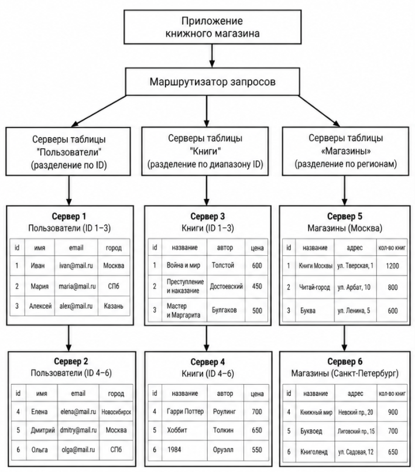
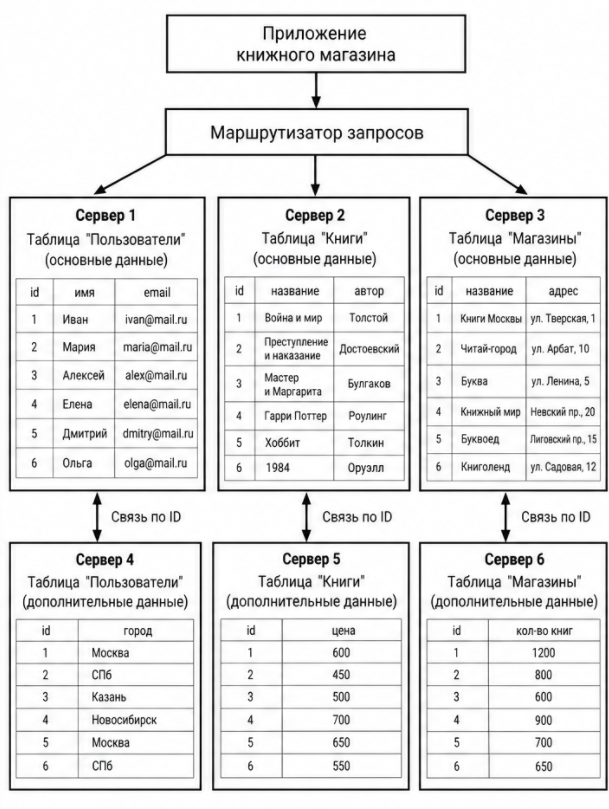

# Домашнее задание к занятию "Репликация и масштабирование. Часть 2" - `Батурин Максим`

### Задание 1

I. Активный master-сервер и пассивный репликационный slave-сервер

Главное преимущество этой схемы — повышение отказоустойчивости системы. Данные с основного master-сервера копируются на резервный slave-сервер. Если основной сервер выходит из строя, резервный можно переключить на его роль, чтобы восстановить работу системы. Такая схема также относительно проста в настройке и обслуживании

II. Master-сервер и несколько slave-серверов

Главное преимущество этой схемы — распределение нагрузки и повышение производительности. Master-сервер отвечает за запись данных, а несколько slave-серверов могут одновременно обрабатывать запросы на чтение. Это позволяет обслуживать больше пользователей, снижать нагрузку на основной сервер и при необходимости добавлять новые серверы. Если один из slave-серверов выходит из строя, остальные могут продолжать работу

### Задание 2

I. Горизонтальный шаринг

Горизонтальный шаринг - это разделение данных одной таблицы на несколько частей по строкам. В каждой части хранятся разные записи, но структура таблиц остаётся одинаковой. Например, база данных книжного магазина состоит из таблиц «Пользователи», «Книги» и «Магазины». Каждую таблицу можно разделить между двумя серверами по определённому правилу.

В таблице «Пользователи» на первом сервере будут храниться пользователи с чётными ID, а на втором — с нечётными. Таблицу «Книги» можно разделить по диапазонам ID: на первом сервере будут книги с ID от 1 до 5000, а на втором — от 5001 до 10000. Таблицу «Магазины» можно разделить по регионам: на одном сервере будут магазины Москвы, а на другом — Санкт-Петербурга.

Для работы системы будет использоваться маршрутизатор запросов, который определяет, на каком сервере находятся необходимые данные. Серверы будут работать в активном режиме и самостоятельно обрабатывать запросы к своим частям базы данных. Для надёжности можно настроить резервные копии или репликацию данных на дополнительные серверы.

II. Вертикальный шаринг

Вертикальный шаринг - это разделение базы данных по столбцам. В отличие от горизонтального шаринга, здесь данные разделяются не по строкам, а по структуре. Для нашей базы данных можно использовать три отдельных сервера: первый будет хранить таблицу «Пользователи», второй — таблицу «Книги», третий — таблицу «Магазины».

В таблице «Пользователи» будут храниться ID пользователя, имя, электронная почта и город. В таблице «Книги» будут находиться ID книги, название, автор и цена. В таблице «Магазины» будут храниться ID магазина, название, адрес и количество книг в наличии.

Приложение будет обращаться к маршрутизатору запросов, который направляет запрос к серверу с нужной таблицей. Например, при получении информации о книге запрос будет направлен на второй сервер, а при получении данных о пользователе — на первый. Если нужно получить данные сразу из нескольких таблиц, система будет объединять результаты по соответствующим ID.

Все три сервера будут работать в активном режиме и обрабатывать запросы к своим данным. Для повышения надёжности можно настроить репликацию на резервные серверы, которые будут хранить копии данных и при необходимости использоваться для чтения или восстановления после сбоя.

